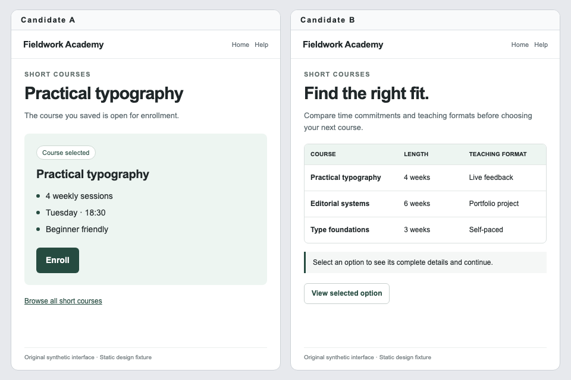

# PurposeUX

**Evaluate a screen against its purpose.**

PurposeUX is a local research toolkit for choosing between two interface candidates in a screenshot, conditioned on an explicit user goal. A screen can be appropriate for one task and unsuitable for another: choosing an already-selected option and comparing several options call for different designs.

The `0.1.0` toolkit release provides a synthetic screenshot dataset, Apple Silicon adapter training, fixed-label inference, and a reproducible baseline-versus-adapter evaluation. The starter model learns a synthetic rubric. It is **not a validated general UX expert**, and its labels do not measure human preference, usability, accessibility, or task completion.

[한국어](README.ko.md) · [Dataset card](docs/DATASET_CARD.md) · [Model card](docs/MODEL_CARD.md) · [Roadmap](docs/ROADMAP.md) · [Sponsor](https://github.com/sponsors/tac0de)



[Download the trained adapter and actual run reports](https://github.com/tac0de/purpose-ux/releases/tag/v0.1.0).
The release contains `summary.json`, full baseline/adapted predictions and a
checksummed adapter archive. See [reproduction and storage](docs/REPRODUCIBILITY.md).

## What it does

- Supplies original synthetic screenshots showing interface candidates `A` and `B`, paired with a purpose and task context.
- Keeps opposing-purpose examples and candidate-order swaps in the same split to limit leakage between train and test.
- Trains a small local LoRA adapter with MLX-VLM on Apple Silicon.
- Compares an unchanged base model with the adapter using the same held-out records and fixed `A`/`B` label scoring.
- Writes machine-readable evaluation output so results can be inspected and reproduced.

This is a starting point for research into whether purpose conditioning changes a model's judgment. A high score on this dataset would establish agreement with its synthetic rubric under the recorded setup; it would not establish real-world UX quality.

## Quickstart

The supported local training path uses an Apple Silicon Mac, Python 3.13, and MLX-VLM 0.7.8. The reference development machine is an M4 MacBook Air with 16 GB of memory. Training on other operating systems, CUDA, and other model architectures is not qualified in this release.

```sh
git clone https://github.com/tac0de/purpose-ux.git
cd purpose-ux
python3.13 -m venv .venv
source .venv/bin/activate
python -m pip install -e .
purposeux doctor
```

The base model is downloaded separately when the model runtime needs it. Its license and access conditions are separate from the code license; review the [model card](docs/MODEL_CARD.md) before use.

Train a local starter adapter:

```sh
purposeux train --data data/train.jsonl --output artifacts/local --iters 64
```

Inspect one held-out prediction:

```sh
purposeux judge --data data/test.jsonl --index 0 --adapter artifacts/local
```

Evaluate the base model and adapter separately:

```sh
purposeux evaluate --data data/test.jsonl --output reports/evaluation-base.json
purposeux evaluate --data data/test.jsonl --adapter artifacts/local --output reports/evaluation-adapter.json
```

Keep both reports together with the training configuration. Compare matching records and model settings, and inspect disagreements as well as aggregate accuracy. The CLI commands generate results locally; this README does not substitute an expected score for an observed run.

## Data and scope

The starter corpus has 176 synthetic records: 128 training, 16 validation, and 32 test records across eight screen families. Six families are assigned to training, one to validation, and one to test. The [dataset card](docs/DATASET_CARD.md) documents the schema, generation provenance, split rules, and limitations.

Training targets are marked `synthetic_rubric`. There are no human preference labels or measured task-success outcomes. Contract fixtures for `T`/`N`/`U` are separate from the trained binary `A`/`B` head; they do not demonstrate trained support for those outputs.

## Use responsibly

Use the toolkit to investigate a hypothesis, inspect purpose sensitivity, and develop better evaluation data. Have people with relevant UX and accessibility expertise review decisions that affect users. Do not present a model label as a usability study, an accessibility audit, or proof that an interface is effective.

Screenshots can contain personal or confidential information. The bundled fixtures are synthetic; any external data you add needs appropriate permission, handling, and provenance.

## Support the research

[GitHub Sponsors](https://github.com/sponsors/tac0de) supports the next evidence-building steps: human annotation, external task datasets, calibration, and generalization to new purposes. See the [funded roadmap](docs/ROADMAP.md) for intended deliverables and their acceptance criteria.

Sponsorship is voluntary support for open-source development. It does not purchase a result, guarantee a delivery date, or imply model performance. Useful contributions also include reproducible failure cases, dataset review, and evaluation improvements. See [CONTRIBUTING.md](CONTRIBUTING.md).

## License

See [LICENSE](LICENSE) for the repository license. Base models and any external datasets retain their own terms. The [dataset card](docs/DATASET_CARD.md) records the bundled data's provenance and licensing scope.
